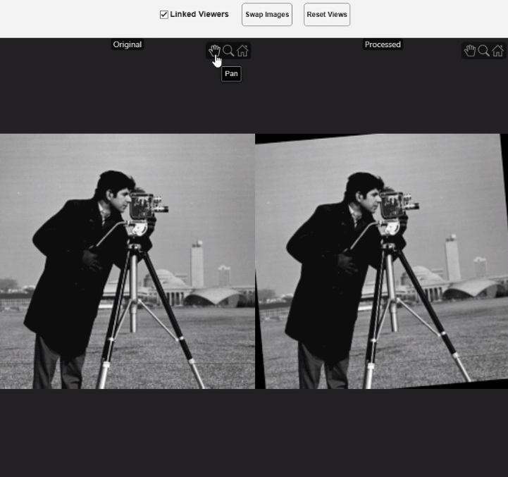

# Image Comparison Tool for Image Processing Toolbox

[](https://matlab.mathworks.com/open/github/v1?repo=MATLAB-Graphics-and-App-Building/Image-Comparison-Tool-for-Image-Processing-Toolbox)

Compare two images side by side with synchronized zoom and pan using a custom App Designer UI component.



## About This Example

Inspecting the effect of an image-processing operation usually means looking at the original and the result together, at the same zoom level and the same region of interest. `ImageComparisonTool` is a custom UI component, built in App Designer, that displays two image viewers with a control bar for linking, swapping, and resetting the views.

This example shows how to configure the component properties, update the displayed images and titles dynamically, and embed the component in a UI figure alongside your own controls to build a custom filtering workflow. It also shows how to open the component in App Designer to modify the layout or the implementation code.

Run `imageComparisonToolDemo` to launch the filtering workflow. The example
uses a slider to update the Gaussian-filtered image and its title while the
original and filtered images remain available for synchronized comparison.

The component provides these interactive controls:

- **Linked Viewers** check box — Synchronize zoom and pan between both viewers
- **Swap Images** button — Swap the images displayed in the left and right viewers
- **Reset Views** button — Restore both viewers to display the full image

## Setup

### Products

Requires MATLAB&reg; R2026b or newer.

Also requires the following MathWorks products:

- Image Processing Toolbox&trade;

## Getting Started

Open `ImageComparisonTool.mlapp` in App Designer, or create the component directly in the Command Window:

```matlab
comp = ImageComparisonTool;
```

Run the complete filtering workflow from the Command Window:

```matlab
imageComparisonToolDemo
```

To inspect or modify the component implementation, open it in App Designer:

```matlab
appdesigner("ImageComparisonTool")
```

## Example Files

| File | Description |
|---|---|
| `ImageComparisonTool.mlapp` | The App Designer UI component for image comparison |
| `imageComparisonToolDemo.m` | Runnable filtering workflow that configures and updates the component |
| `imageComparisonUI.gif` | Animation showing the component in use |

## License

The license is available in the [license.txt](license.txt) file in this GitHub&reg; repository.

## Community Support

[MATLAB Central](https://www.mathworks.com/matlabcentral)

Copyright 2026 The MathWorks, Inc.
